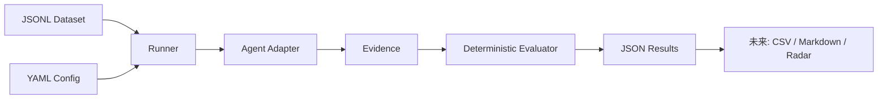

# MemoryScope-OK

面向 openKylin 的 AI Agent 长期记忆自动化 Benchmark。通过标准化 JSONL 数据、统一 Adapter、执行证据与可解释评分，比较 retention、retrieval、dynamic update、disambiguation、boundary、reuse 六项能力。

**当前是首轮离线骨架，只有 1 条 Retention 用例与 DemoAgent。Demo 的实际程序执行结果用于验证评测流水线，不代表真实 AI Agent 能力。** 真实 Agent、完整六维、12/48 条数据、CSV/Markdown/雷达图与 openKylin 验证都属于后续阶段。详见 [进度](STATUS.md)。

## 安装

需要 Python 3.10+。在项目根目录执行：

```bash
python3 -m venv .venv
source .venv/bin/activate
python -m pip install -e '.[dev]'
```

如果系统 `python3` 低于 3.10，请改用已安装的合适解释器，例如 `python3.13 -m venv .venv`。依赖安装需要软件源访问；离线评测本身不访问 API，无需密钥。

## Quick start

```bash
memoryscope --help
memoryscope list-agents
memoryscope validate datasets/golden
memoryscope run configs/demo.yaml
pytest -q
```

也可用 `python -m memoryscope` 替代 `memoryscope`。配置中的 dataset/output_dir 相对于配置文件解析，必须留在项目根目录内；从其他工作目录运行时，传入配置的完整路径。

每次运行写入新的 `runs/<run_id>/`，包含 `metadata.json`、`results.json`、`events.jsonl`、数据与配置快照。用 `memoryscope report runs/<run_id>` 查看已保存结果；该命令不会重新调用 Agent。不要把第一次示例的 run_id 当成固定路径。

只有 Retention 维度有成绩；其余维度和整体六维总分为 `null`。这避免把缺测当成 0 分或满分。`synthetic` 标签必须随结果保留。

## 工作流



核心包位于 `src/memoryscope/`。`datasets/schema/case.schema.json` 是当前模型导出的机器可读契约；`datasets/golden/retention.jsonl` 是首条候选用例。未来 probe/评分类型通过版本化 schema 扩展，当前不支持的值直接拒绝。

Demo 在收到偏好消息时存储一项确定性记忆，经过干扰和 session 重置后回答 probe。Runner 不把标准答案传给 Adapter。评分器分别检查必须出现与禁止出现的文本，并保留理由与证据引用。这只是用于框架测试的受控实现。

## openKylin

设计目标是 Python 3.10+ / Linux；目前未在 openKylin 实机运行，不能声称已适配通过。计划验证安装、全部测试、两个真实 Agent、报告与无显示器环境下的雷达图生成。设备和发行版确定后按 [执行计划 Phase 8](IMPLEMENTATION_PLAN.md) 记录 OS、架构、Python、依赖版本和实际输出。

## 继续开发

- [项目说明书](PROJECT_SPEC.md)：需求、协议、架构、安全、验收与未核实事项。
- [九阶段执行计划](IMPLEMENTATION_PLAN.md)：阶段任务、检查与完成标准。
- [架构评审](ARCHITECTURE_REVIEW.md)：六点建议、建议执行顺序及近期验收。
- [工作约定](AGENTS.md)：后续 Codex 开发规范。
- [进度](STATUS.md) 与 [待办](TODO.md)：以实际验证为准。
- [贡献指南](CONTRIBUTING.md)：用例、代码和证据提交约定。

项目采用 [MIT License](LICENSE) 作为初始开发选择；比赛、第三方 Agent 与数据的许可要求仍需分别核实。当前未发布远程仓库。
